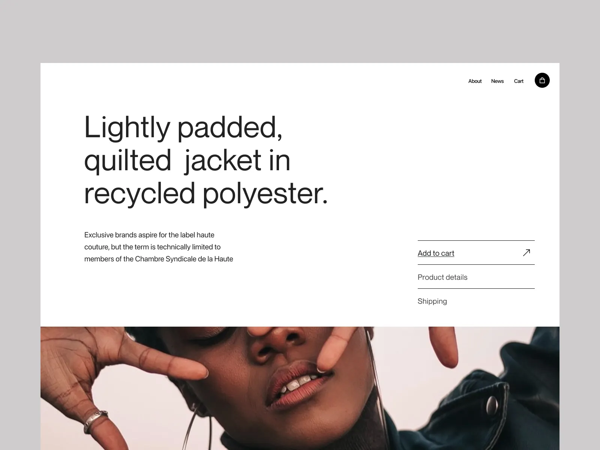
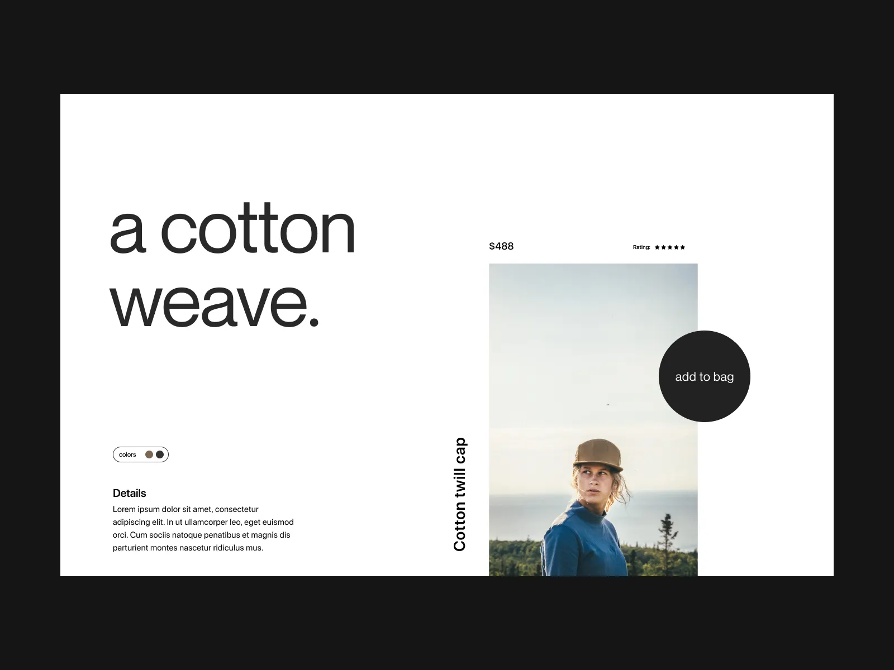
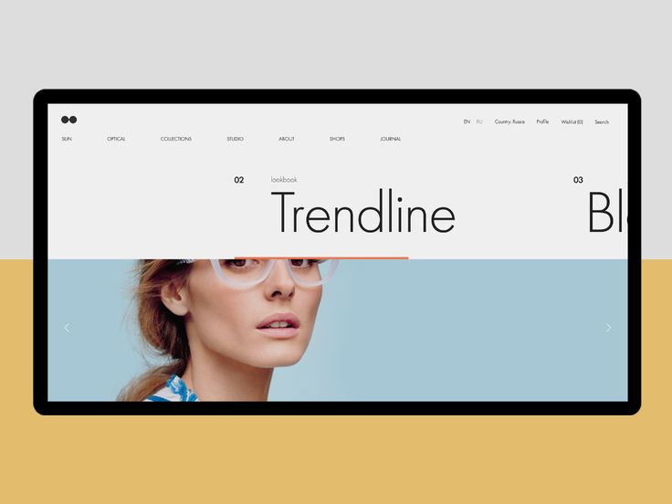

# Frontend Lab

An independent collection of frontend projects created for learning, practice, and portfolio demonstrations.
Some pages are UI recreations and are clearly labeled as independent, fictional previews. They are not affiliated
with or endorsed by the brands they may reference. The demonstrations do not collect credentials or sensitive
personal information.

Open [the project gallery](./index.html) to explore the available demos.

## Projects and Their Designs

### [Project 1](./projects/Project-1/)

A simple project demonstrating basic HTML, CSS concepts.

### [Project 2](./projects/Project-2/)

A slightly advanced project focusing on cool layout and interactivity.

### [Project 3](./projects/Project-3/)

A creative project to revise and apply learned concepts.

The gallery also includes several independently maintained Git submodules. Update a submodule and its parent
repository pointer together when publishing changes to a submodule project.
